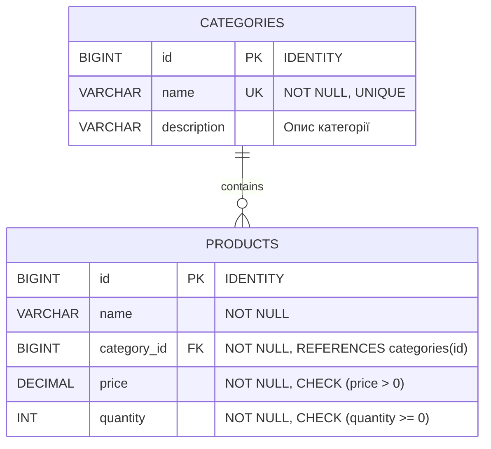

# Лабораторна робота №10: Maven як інструмент побудови проєкту. Робота з реляційною БД через JDBC

> [!IMPORTANT]
> **Вимога до тестового середовища (Окрема тестова БД):**
> Демонстраційний клас `CrudDemo` розроблено для запуску виключно на **виділеній тестовій базі даних** PostgreSQL (`shopdb` або `shopdb_test`).
> Демонстрація оперує фіксованими тестовими сутностями (товари 101, 102, 103, 201, 202, 401; категорії 1, 2, 3), які перевіряють транзакції, відкати (rollback) та обмеження `ON DELETE RESTRICT`. Очищення тестових ID здійснюється у блоці `finally`. Запуск на базах з реальними робочими даними заборонено, оскільки програма видаляє задіяні в тесті ідентифікатори без перевірки їхнього походження!

## Предметна область та опис сутностей

У системі визначено базовий клас `BaseEntity` та сутності інтернет-магазину:

1. **`BaseEntity`** (`entity/BaseEntity.java`):
   - `id` (`long`) — унікальний ідентифікатор;
   - `name` (`String`) — назва або ім'я сутності;
   - Методи `equals()` та `hashCode()` перевизначені за `id` з перевіркою типу через `getClass()`.
2. **`Category`** (`entity/Category.java`):
   - Успадковує `id` та `name` від `BaseEntity`;
   - `description` (`String`) — опис категорії товарів.
3. **`Product`** (`product/Product.java`):
   - Успадковує `id` та `name` від `BaseEntity`;
   - `price` (`double`) — ціна товару (має бути більшою за 0);
   - `quantity` (`int`) — кількість на складі (перевірка `quantity >= 0`);
   - `categoryId` (`long`) — зовнішній ключ, що вказує на категорію товару.
4. **`Customer`** (`Customer.java`):
   - Успадковує `id` та `name` від `BaseEntity`;
   - `phone` (`String`) — номер телефону покупця з перевіркою формату.

---

## 1. Схема бази даних (ER-діаграма)

У проєкті створено зв'язок «один до багатьох» (1:N): одна категорія (`categories`) може містити багато товарів (`products`). Як реляційну СУБД обрано **PostgreSQL**.



### Таблиця зв'язків та обмежень:
| Таблиця | Стовпець | Тип | Обмеження | Опис |
|---|---|---|---|---|
| `categories` | `id` | `BIGINT` | `PRIMARY KEY (IDENTITY)` | Первинний ключ категорії |
| `categories` | `name` | `VARCHAR(100)` | `NOT NULL, UNIQUE` | Унікальна назва категорії |
| `categories` | `description` | `VARCHAR(255)` | `NULL` | Текстовий опис категорії |
| `products` | `id` | `BIGINT` | `PRIMARY KEY (IDENTITY)` | Первинний ключ товару |
| `products` | `name` | `VARCHAR(100)` | `NOT NULL` | Назва товару |
| `products` | `category_id` | `BIGINT` | `FOREIGN KEY, NOT NULL` | Посилання на `categories(id)` |
| `products` | `price` | `DECIMAL(10, 2)` | `NOT NULL, CHECK (price > 0)` | Ціна товару |
| `products` | `quantity` | `INT` | `NOT NULL, CHECK (quantity >= 0)` | Кількість на складі |

> **Примітка щодо ідентифікаторів:** У реляційній БД зберігається базова сутність `Product`. Значення `id` призначаються програмою при збереженні (ручне керування ключами згідно з логікою попередніх лабораторних робіт).

### Індекси у схемі БД (`init.sql`):
1. **`idx_products_category`** (`ON products(category_id)`) — прискорює операції вибірки товарів за категорією та перевірку обмеження зовнішнього ключа під час видалення (`ON DELETE RESTRICT`).
2. **`idx_products_name`** (`ON products(name)`) — прискорює пошук за назвою товару та сортування `ORDER BY name`.

---

## 2. Пояснення правила ON DELETE RESTRICT

Для зв'язку між товарами та категоріями обрано правило `ON DELETE RESTRICT`:
```sql
FOREIGN KEY (category_id) REFERENCES categories (id) ON DELETE RESTRICT
```

**Чому саме `RESTRICT`:**
1. **Захист від випадкового видалення:** Якщо спробувати видалити категорію, в якій ще є товари, PostgreSQL заблокує видалення і поверне помилку порушення цілісності. При `CASCADE` усі ці товари видалилися б автоматично.
2. **Логіка магазину:** Якщо використати `SET NULL`, товари залишилися б взагалі без категорії (`category_id = NULL`), а в нашому магазині кожен товар обов'язково належить до якоїсь категорії.
3. Категорію можна видалити тільки тоді, коли вона порожня (товари з неї вже видалені або перенесені).

---

## 3. Захист від SQL-ін'єкцій (Демонстрація `Statement` vs `PreparedStatement`)

Для перевірки використовується рядок SQL-ін'єкції:

```text
' OR '1'='1
```

### 1. Небезпечний варіант (`Statement`)

> **Примітка:** Цей метод наведено лише як навчальний приклад для демонстрації вразливості і не включено в основний код проєкту (`JdbcProductService.java`).

```java
// НЕБЕЗПЕЧНО: приклад лише для демонстрації
public void unsafeSearch(Connection connection, String name) throws SQLException {
    String sql = "SELECT * FROM products WHERE name = '" + name + "'";

    try (Statement st = connection.createStatement();
         ResultSet rs = st.executeQuery(sql)) {

        while (rs.next()) {
            System.out.println(rs.getString("name"));
        }
    }
}
```

При формуванні SQL-запиту шляхом конкатенації рядків введення користувача (`' OR '1'='1`) потрапляє безпосередньо в структуру SQL-команди:

```sql
SELECT * FROM products WHERE name = '' OR '1'='1'
```

Оскільки умова `'1'='1'` завжди істинна, запит повертає **всі товари** з таблиці, а не лише товар із заданою назвою. Це демонструє небезпеку SQL-ін'єкцій.

### 2. Безпечний варіант (`PreparedStatement`)

Саме такий підхід реалізовано в робочому коді [`JdbcProductService.java`](src/main/java/service/JdbcProductService.java):

```java
public List<Product> findByName(String name) {
    String sql = "SELECT * FROM products WHERE name = ?";
    List<Product> products = new ArrayList<>();

    try (Connection c = DBConnection.getInstance().getConnection();
         PreparedStatement pst = c.prepareStatement(sql)) {

        pst.setString(1, name);

        try (ResultSet rs = pst.executeQuery()) {
            while (rs.next()) {
                products.add(mapRow(rs));
            }
        }

    } catch (SQLException e) {
        throw new RuntimeException("Помилка пошуку товару за назвою", e);
    }

    return products;
}
```

Тут `?` — це параметр запиту. У цьому випадку введений рядок `"' OR '1'='1"` передається через `pst.setString(1, name)` як звичайне текстове значення (літерал), а не як частина SQL-команди. Тому ін'єкція не змінює логіку запиту.

### 3. Порівняння результатів

| Перевірка | `Statement` | `PreparedStatement` |
| :--- | :--- | :--- |
| Введення | `' OR '1'='1` | `' OR '1'='1` |
| Чи змінюється логіка SQL? | Так | Ні |
| Очікуваний результат | Усі товари | 0 товарів, якщо такої назви немає |
| Захист від SQL-ін'єкції | Немає | Є |

**Фактичний результат виконання в `CrudDemo`:**
```text
--- Захист від SQL-ін'єкцій ---
Пошук '' OR '1'='1' через PreparedStatement (безпечно): 0 записів
```

**Висновок:** `PreparedStatement` захищає від SQL-ін'єкцій завдяки параметризованим запитам. Небезпечний метод із `Statement` наведено лише як навчальний приклад і не включено в основний код проєкту.

---

## 4. Транзакції та відкат (ROLLBACK)

Додавання категорії разом із товарами (`createCategoryWithProducts`) виконується в одній транзакції:
1. `c.setAutoCommit(false);` — вимикаємо автозбереження після кожного запиту.
2. Додаємо категорію.
3. Додаємо товари в циклі.
4. Якщо виникає помилка (наприклад, дублікат первинного ключа товару), спрацьовує блок `catch`, де викликається `c.rollback()`.
5. Завдяки цьому жоден запис не зберігається, і база даних повертається до свого початкового стану (атомарність).

---

## 5. Шаблонний метод (Template Method) в AbstractJdbcCrudService (Рівень 3)

Спільну роботу з базою винесено в абстрактний клас `AbstractJdbcCrudService<T extends BaseEntity> implements CRUDService<T>`:
* **Загальний алгоритм (шаблонні методи):** методи `findById`, `save`, `delete`, `findAll`, `findAllSortedByName`, `findAllSorted`, `count` реалізують спільний каркас взаємодії з БД (отримання з'єднання з пулу HikariCP, підготовка PreparedStatement, виконання та обробка помилок).
* **Логіка методу `save(T entity)`:** метод реалізовано без попереднього надлишкового `SELECT`. Якщо `entity.getId() > 0`, спочатку виконується `UPDATE`. Якщо `UPDATE` змінив більше 0 рядків, оновлення успішно завершено. Якщо ж оновлено 0 рядків (запису з таким ID ще не було в БД) або `entity.getId() <= 0`, виконується `INSERT`.
* **Методи для підкласів (`protected abstract`):** кожен конкретний сервіс (наприклад, `JdbcCategoryService` або `JdbcProductService`) визначає лише свої SQL-запити (`getSelectByIdSql`, `getInsertSql`, `getUpdateSql`, `getDeleteByIdSql` тощо), створення об'єкта з рядка `mapRow(ResultSet)`, а також передачу параметрів:
  * `setInsertParameters(PreparedStatement, T)`
  * `setUpdateParameters(PreparedStatement, T)`
* **Чому параметри розділено:** порядок і кількість стовпців для `INSERT` та `UPDATE` відрізняються (в `UPDATE` поле `id` стоїть у кінці в секції `WHERE id = ?`), тому зручніше мати два окремих методи.

---

## 6. Пул з'єднань HikariCP та Singleton (Рівень 3)

У проєкті реалізовано варіант (a): **потокобезпечний Singleton, який видає з'єднання з пулу HikariCP (`maximumPoolSize = 5`)**.

### Чому не можна тримати одне спільне підключення `Connection` у Singleton:
1. **Конфлікти між потоками:** Об'єкт `Connection` не підтримує одночасну роботу кількох потоків. Якщо два потоки одночасно звернуться до одного підключення, це призведе до помилок.
2. **Проблеми з транзакціями:** Якщо один потік виконає `setAutoCommit(false)`, а інший паралельно викличе `commit()` або свій запит, вони перемішають і зламають дані один одного.
3. **Розрив зв'язку:** Якщо одне спільне з'єднання обірветься (через таймаут чи збій мережі), уся програма більше не зможе працювати з БД.

### Як працює з HikariCP:
Клас `DBConnection` ініціалізує пул `HikariDataSource`. Коли потрібно виконати запит, сервіс бере тимчасове з'єднання з пулу через `try-with-resources`. Після завершення блоку метод `close()` не закриває підключення, а повертає його назад у пул для інших запитів.

---

## 7. Пакетні операції (addBatch / executeBatch) (Рівень 3)

Порівняння швидкості додавання 1000 товарів у **PostgreSQL** (фактичні вимірювання під час запуску `CrudDemo` командою `mvn exec:java`):

| Спосіб | Час виконання (1000 записів) |
|---|---|
| По одному (`save()` у циклі) | **400 мс** |
| Пакетно (`insertBatch()`: `addBatch()` + `executeBatch()`, 1 commit) | **38 мс** |

Пакетна вставка у PostgreSQL відпрацювала більш ніж у **10 разів швидше** за поштучне збереження через `save()` (фактичний вивід `CrudDemo`).

```text
--- Демонстрація пакетної вставки (Batch vs Single) ---
По одному (1000 записів): 400 мс
Пакетно   (1000 записів): 38 мс
```

### Чому пакетний спосіб швидший:
1. **Зменшення накладних витрат:** `addBatch()` накопичує SQL-операції в одному `PreparedStatement`, а `executeBatch()` виконує їх пакетом, що значно зменшує витрати часу на окреме відкриття з'єднання з пулу, передавання та обробку кожного запиту.
2. **Одна транзакція з одним `commit()`:** При вставці по одному кожен запит підтверджується окремо (`autoCommit = true`). У пакетній вставці використовується одна спільна транзакція (`setAutoCommit(false)`) з одним викликом `commit()`, що мінімізує операції запису в журнал транзакцій (WAL).

---

## 8. Посторінкове читання (Пагінація LIMIT/OFFSET) (Рівень 3)

Для отримання товарів частинами реалізовано метод `findPage(int page, int size)`.

SQL-запит:
```sql
SELECT id, name, category_id, price, quantity FROM products ORDER BY id ASC LIMIT ? OFFSET ?
```

### Особливості та обмеження пагінації:
* **`LIMIT`** визначає кількість товарів на сторінці, а **`OFFSET`** — скільки записів потрібно пропустити від початку: `(page - 1) * size`.
* **Навіщо `ORDER BY id ASC`:** Без сортування реляційна база не гарантує однаковий порядок рядків. Сортування за `id` забезпечує передбачуваний порядок, щоб при переході між сторінками записи не дублювалися і не губилися.
* **Чому `findAll()` без обмежень небезпечний:**
  1. *Оперативна пам'ять:* Завантаження великих таблиць перевантажує heap JVM і створює ризик перевитрати пам'яті (`OutOfMemoryError`).
  2. *Мережа:* Передавання масивних наборів даних створює надлишковий трафік між сервером PostgreSQL та застосунком.
  3. *Час відгуку:* Тривале сканування всієї таблиці навантажує диск і блокує ресурси бази даних.
* **Обмеження пагінації `OFFSET`:**
  1. На великих зсувах (наприклад, `OFFSET 100000`) СУБД змушена прочитати та відкинути всі попередні рядки, тому запит виконується повільніше.
  2. Стабільність сторінок зберігається лише для незмінних даних: якщо між читанням сторінок паралельно додаються або видаляються рядки, межі сторінок можуть тимчасово зміщуватися.

---

## 9. Інструкція із запуску проєкту з нуля

### Передумови:
* Встановлена Java JDK 25 (вказана як цільова версія у `pom.xml`).
* Встановлений Apache Maven 3.9+.
* Запущений локальний сервер **PostgreSQL** зі створеною базою даних `shopdb`.

### Кроки запуску:
1. **Створення бази даних у PostgreSQL:**
   ```sql
   CREATE DATABASE shopdb;
   ```

2. **Налаштування підключення до PostgreSQL:**
   У папці `src/main/resources` створіть файл `application.properties` на основі `application.properties.example`.

   Вкажіть параметри підключення до локальної тестової бази даних:
   ```properties
   db.url=jdbc:postgresql://localhost:5432/shopdb
   db.user=postgres
   db.password=YOUR_PASSWORD
   db.pool.max-size=5
   ```
   Замініть `YOUR_PASSWORD` на пароль вашого користувача PostgreSQL.

   Клас `DBConnection` зчитує ці параметри з файлу `application.properties` і створює пул з'єднань HikariCP.

   > **Важливо:** файл `application.properties` містить локальні налаштування підключення та не повинен додаватися до Git. Для цього його необхідно вказати у `.gitignore`.

   Під час запуску `CrudDemo` викликається `DatabaseInitializer.init()`, який використовує `init.sql` для створення таблиць та індексів.

3. **Вимоги до тестової бази даних та межі ізоляції демонстрації:**
   > **Важливо:** Демонстраційний клас `CrudDemo` призначений для запуску виключно на **окремій тестовій базі даних** PostgreSQL (`shopdb` або `shopdb_test`).
   >
   > - `CrudDemo` оперує фіксованими тестовими ідентифікаторами (товари 101, 102, 103, 201, 202, 401; партії бенчмарку 10000..20999; категорії 1, 2, 3).
   > - **Видалення за конкретними ID:** Усі операції очищення бенчмарку та демо виконуються строго за переліком конкретних тестових ID через метод `delete(id)`.
   > - **Дотримання `ON DELETE RESTRICT`:** Очищення здійснюється у строгому порядку — спочатку видаляються дочірні тестові товари, а потім категорії. Це гарантує, що обмеження зовнішнього ключа не блокує процес.
   > - **Фінальне очищення (`try ... finally`):** Тестові записи бенчмарку гарантовано очищаються у блоці `finally`.

4. **Компіляція проєкту через Maven:**
   ```bash
   mvn clean compile
   ```

5. **Запуск програми:**
   ```bash
   mvn exec:java
   ```
   *Запускається клас `CrudDemo`, який демонструє роботу `JdbcProductService`, сортування за назвою та ціною, транзакцію з відкатом, перевірку `ON DELETE RESTRICT`, захист від SQL-ін'єкцій, бенчмарк пакетної вставки, посторінкове читання (пагінацію) та взаємозамінність через інтерфейс `ProductService`.*

---

## 10. Попередні роботи (ЛР №7-9: CRUD-сервіс в оперативній пам'яті)

У попередніх лабораторних роботах було реалізовано:
* Узагальнений інтерфейс `CRUDService<T extends BaseEntity>` та його реалізацію в оперативній пам'яті `InMemoryCrudService<T>`.
* Сервіс `ProductService` та `InMemoryProductService` із сортуванням за назвою (`findAllSortedByName`) та за назвою і ціною (`findAllSortedByNameAndByPrice`).
* Узагальнений метод `findAllSorted(Comparator<? super T> comparator)` з використанням wildcards `? super T`.
* Ієрархію сутностей `Product` (включаючи `Clothing`, `Electronics`) та `Customer` із перевіркою коректності полів та обробкою винятків.
