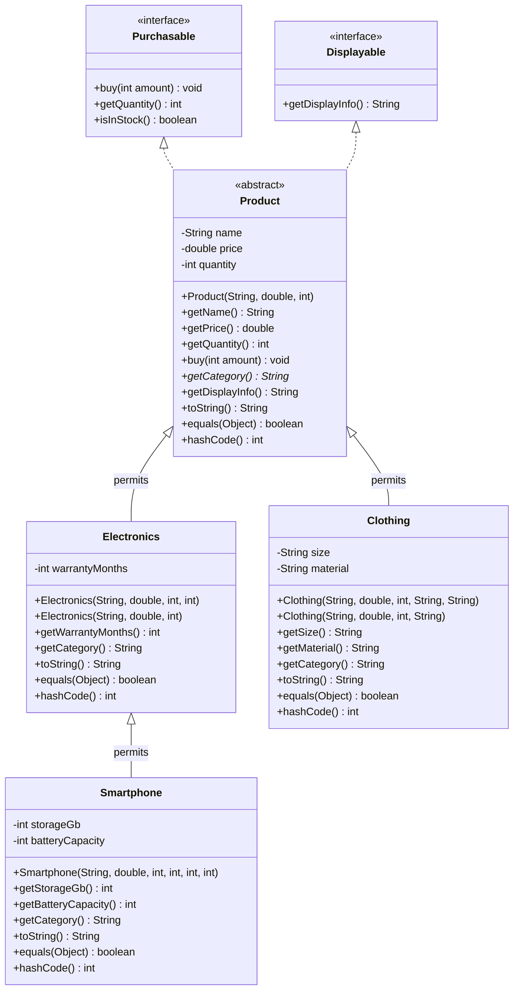

# Лабораторна робота №6: Реалізація ієрархії класів на основі принципів наслідування

## Предметна область: Інтернет-магазин

Ця лабораторна робота є логічним продовженням та архітектурним рефакторингом попередніх ЛР №1–5.
Мета роботи — засвоїти механізм наслідування в Java: проєктування ієрархії за принципом «is-a», ланцюжок викликів конструкторів (`super`, `this`), перевизначення методів, абстрактні класи, поліморфну поведінку колекцій об'єктів, контракти `equals()` / `hashCode()`, а також переваги сучасних запечатаних ієрархій (**Sealed Classes**) та **Pattern Matching** у Java 21+.

---

## 1. Концепція та перевірка зв'язків «is-a» (є різновидом)

До рефакторингу тип товару визначався простим строковим полем `private final String category` у єдиному монолітному класі `Product`. Це не дозволяло валідувати специфічні характеристики (гарантія для техніки, розмір і тканина для одягу, акумулятор і пам'ять для смартфонів).

Перед написанням коду спроєктовано та перевірено відношення «is-a»:

| Відношення класів | Перевірка словами («is-a» / «has-a») | Доречність наслідування |
|---|---|---|
| **`Smartphone` → `Electronics`** | Смартфон **є різновидом** електроніки («is-a») | **ТАК**: успадковує гарантійний термін і додає пам'ять та акумулятор. |
| **`Electronics` → `Product`** | Електроніка **є різновидом** товару («is-a») | **ТАК**: успадковує назву, ціну, залишок і додає гарантію. |
| **`Clothing` → `Product`** | Одяг **є різновидом** товару («is-a») | **ТАК**: успадковує базові поля товару і додає розмір та матеріал. |
| **`Order` → `Product`** | Замовлення **має** товар («has-a») | **НІ (Композиція)**: замовлення не є товаром, наслідування порушило б LSP. |
| **`SaleProduct` → `Product`** | Товар зі знижкою | **НІ (Антипатерн)**: знижка є змінним станом/поведінкою, а не сталим типом. Призвело б до комбінаторного вибуху (`SaleSmartphone`, `SaleClothing`). Вирішено через композицію (`Order` містить `DiscountStrategy`). |

---

## 2. Діаграма класів ієрархії (Mermaid)



---

## 3. Деталі реалізації за рівнями складності

### Рівень 1. Базовий
- **Базовий клас `Product`:** винесено спільні поля (`name`, `price`, `quantity`), конструктор та базові методи. Усі поля інкапсульовані як `private`.
- **Підкласи:** `Electronics` та `Clothing` містять виключно власні специфічні поля.
- **Ланцюжок `super(...)`:** у конструкторах усіх підкласів першим оператором викликається конструктор батьківського класу `super(...)`.
- **Перевизначення `toString()`:** кожен підклас перевизначає `toString()`, обов'язково викликаючи `super.toString()` і конкатенуючи свої унікальні поля.
- **Поліморфізм у циклі:** у методі `printProducts` масив базового типу `Product[]` обробляється в єдиному циклі, де динамічно викликаються перевизначені методи `toString()` та `getCategory()`.

### Рівень 2. Середній
- **Абстрактний клас і метод:** клас `Product` оголошено як `abstract`, оскільки створення абстрактного екземпляра «товару взагалі» в інтернет-магазині не має сенсу.
- **Абстрактний метод `public abstract String getCategory()`:** прямий рефакторинг старого поля `category: String`. Тепер неможливо забути або спотворити категорію — кожен підклас зобов'язаний реалізувати її повернення. `Smartphone` перевизначає `getCategory()`, повертаючи "Смартфон".
- **Конкретний клас `Electronics`:** оголошений як `sealed`, але **НЕ** `abstract`, оскільки в магазині продається загальна електроніка (навушники, зарядні пристрої, кабелі), для яких створення підкласу `Smartphone` було б надлишковим.
- **Три рівні ієрархії:** `Product` (1-й рівень) → `Electronics` (2-й рівень) → `Smartphone` (3-й рівень).
- **Повідомлення в конструкторах:** у кожному конструкторі виведено лог `[ЛОГ КОНСТРУКТОР]`, що підтверджує порядок ініціалізації: від базового класу до нащадка.
- **Делегування конструкторів `this(...)`:**
  - `Electronics(name, price, quantity)` делегує до `this(name, price, quantity, DEFAULT_WARRANTY_MONTHS)` (гарантія 12 міс. за замовчуванням).
  - `Clothing(name, price, quantity, size)` делегує до `this(name, price, quantity, size, DEFAULT_MATERIAL)` (матеріал "Бавовна" за замовчуванням).
- **Модифікатор `final`:**
  - Метод `buy(int amount)` у `Product` оголошено як `final`, щоб жоден підклас не міг порушити логіку перевірки та списання залишків на складі.
  - Класи `Clothing` та `Smartphone` оголошено як `final`, оскільки їхня спеціалізація завершена.
- **Звернення до методів підкласу через базове посилання:**
  - У чеку замовлення (`Order.printReceipt`): перевірка `if (product instanceof Electronics e)` дозволяє викликати специфічний метод `e.getWarrantyMonths()`. Оскільки змінна має статичний тип `Product` (оголошений під час компіляції), але динамічний тип `Electronics` або `Smartphone` (фактичний об'єкт у купі), pattern matching безпечно приводить тип без ризику помилок.
  - У пункті меню 8 продемонстровано обробку `ClassCastException` при спробі некоректного явного приведення `(Smartphone) someProduct` (де об'єкт є одягом), і показано безпечний варіант через `instanceof`.

### Рівень 3. Високий
- **Перевизначення `equals()` та `hashCode()`:**
  - Виключено поле `quantity`: кількість товару є змінним станом складу (`buy()`), і її включення призвело б до зміни хеш-коду мутабельного об'єкта під час роботи програми, що зламало б роботу в `HashSet` / `HashMap`. Рівність базується виключно на незмінній ідентичності товару.
  - **Дослідження симетрії:** порівняння `getClass() != obj.getClass()` замість `instanceof`. Якби `Electronics` використовував `instanceof Electronics`, то `baseElectronics.equals(subSmartphone)` повернув би `true` (бо смартфон є електронікою), а `subSmartphone.equals(baseElectronics)` повернув би `false` (бо базовий об'єкт не має полів пам'яті та батареї). Це порушило б фундаментальну властивість симетрії $a = b \iff b = a$. Завдяки `getClass()` симетрія зберігається: обидва виклики повертають `false`.
- **Композиція замість наслідування:** детально обґрунтовано в пункті 1 (чому `Order` містить `Product`, а знижки реалізовано через патерн Strategy, а не через антипатерн `SaleProduct`).

### Самостійне опрацювання (Sealed Classes + Switch Pattern Matching)
- Ієрархію оголошено через `sealed class Product permits Electronics, Clothing` та `sealed class Electronics permits Smartphone`.
- У методі друку чека (`Order.printReceipt`) сформовано правила гарантійного сервісу через вираз `switch (product)` з pattern matching без блоку `default`:
  ```java
  String servicePolicy = switch (product) {
      case Smartphone s -> "Правила сервісу: гарантійне обслуговування в авторизованому СЦ (пам'ять " +
              s.getStorageGb() + " ГБ, батарея " + s.getBatteryCapacity() + " мАг). Збережіть коробку!";
      case Electronics e -> "Правила сервісу: гарантійний ремонт за наявності чека (термін " +
              e.getWarrantyMonths() + " міс.).";
      case Clothing c -> "Правила сервісу: повернення/обмін протягом 14 днів (розмір " +
              c.getSize() + ", матеріал: " + c.getMaterial() + ", фабричні бирки мають бути збережені).";
  };
  ```
- **Гарантія компілятору:** запечатана ієрархія точно фіксує перелік можливих підтипів на етапі компіляції. Компілятор перевіряє вичерпність (exhaustiveness), тому гілка `default` не потрібна.
- **Вимога домінування (Dominance):** `case Smartphone s` обов'язково повинен стояти перед `case Electronics e`, інакше компілятор видасть помилку: підклас виявиться недосяжним через перехоплення загальним батьківським класом.

---

## 4. Що потрібно змінити у разі додавання нового підкласу товару?

Якщо в асортимент інтернет-магазину додається нова категорія, наприклад `Book` (Книга):
1. Створити клас `public final class Book extends Product` з власними специфічними полями (`author`, `isbn`, `pagesCount`).
2. Додати `Book` у список дозволених класів базового класу `Product`:
   ```java
   public abstract sealed class Product permits Electronics, Clothing, Book
   ```
3. Додати створення книги у фабрику `ProductFactory` та пункт вибору в меню `Main.java`.
4. **Головна перевага `sealed`:** компілятор Java одразу знайде та підсвітить помилкою всі вирази `switch (product)`, де відсутня гілка `case Book b`, вимагаючи додати бізнес-правила повернення для книг. Жодне місце в системі не буде забуто!

---

## 5. Інструкція запуску програми

### Через run.bat:
```cmd
run.bat
```

### Через консоль (PowerShell / CMD):
```powershell
javac -encoding UTF-8 -sourcepath src -d out src\Main.java
java -cp out -Dfile.encoding=UTF-8 Main
```

> **Примітка:** Пункт меню **8** запускає автоматичну діагностику: наочно демонструє ланцюжок 3 рівнів конструкторів, математичну симетрію `equals()` та безпечне приведення типів (перехоплення `ClassCastException` проти `instanceof`).
